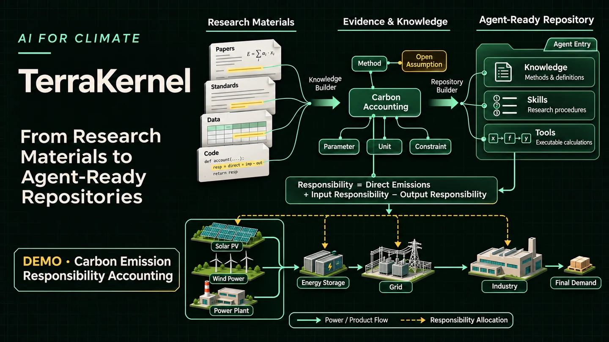
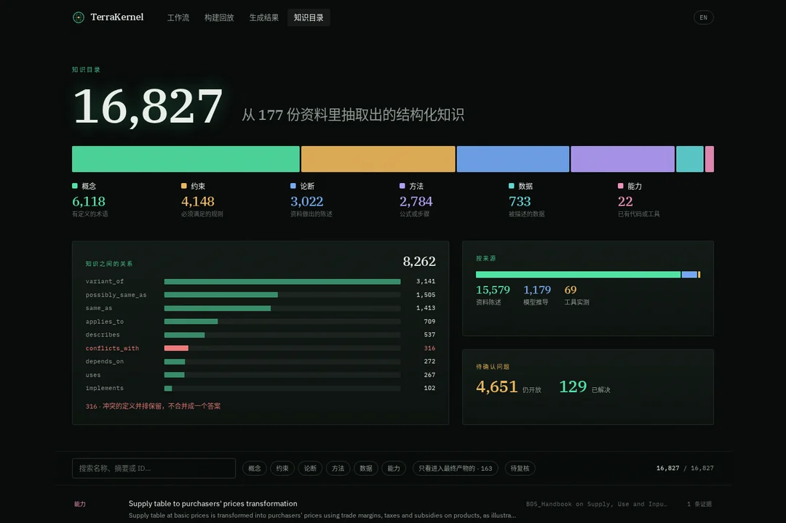
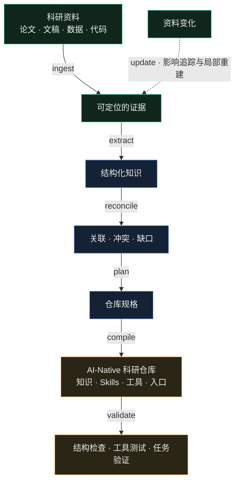

<h1 align="center">🌍 TerraKernel</h1>

<p align="center">
  <strong>把科研资料，编译成 Agent 可以直接使用的研究仓库。</strong><br>
  <em>From research materials to agent-ready repositories.</em>
</p>

<p align="center">
  <a href="https://typhoon112.github.io/terrakernel/"><strong>▶ 在线演示</strong></a> &nbsp;·&nbsp;
  <a href="#安装"><strong>🚀 快速开始</strong></a> &nbsp;·&nbsp;
  <a href="#如何工作">⚙️ 工作原理</a> &nbsp;·&nbsp;
  <a href="#生成的仓库">📦 生成结果</a>
</p>

<p align="center">
  <code>AI4Climate Hackathon</code> &nbsp; <code>Python 3.12+</code> &nbsp;
  <a href="LICENSE"><strong>PolyForm Noncommercial</strong></a>
</p>

<p align="center">
  <a href="https://typhoon112.github.io/terrakernel/">
    
  </a>
</p>

> [!TIP]
> **第一次来？** [打开在线演示](https://typhoon112.github.io/terrakernel/)，从一个真实的碳排放责任核算案例，看资料如何变成知识、Skills 和工具。想处理自己的资料，直接跳到[快速开始](#安装)。

TerraKernel 是 **AI4Climate 黑客松参赛项目**，也是一个可在本机运行的科研资料编译工具。

**📥 输入**：论文、文稿、网页快照、数据表、代码和图表，加上一句研究目标。<br>
**📦 输出**：一个包含 **知识 + Skills + 工具 + Agent 入口** 的研究仓库，供 Claude Code、Codex 等 Agent 直接使用。

<a name="从资料到可用的研究能力"></a>

## ✨ 从资料到可用的研究能力

- **🔎 知识有出处** — 保留原文定位与摘录，区分资料陈述、模型推导和工具实测。
- **🧩 方法可执行** — 将研究步骤组织为 Skills，将计算方法编成附验证状态的工具。
- **⚖️ 冲突看得见** — 不同定义并列保留；缺失信息进入待确认清单，留给研究者复核。
- **🔄 变化可追踪** — 追踪资料与产物的依赖，支持资料更新后的局部重建。
- **🤖 Agent 可接入** — 生成 `AGENTS.md`、`CLAUDE.md`、Agent Skills 与 MCP 工具接口。

<a name="看一次真实构建"></a>

## 🎬 看一次真实构建

**演示案例 · 碳排放责任核算**<br>
从分散的科研资料中提取定义、公式、参数与边界，再编成知识文档、研究流程和计算工具。

| 📚 资料 | 🔎 证据单元 | 🧠 知识对象 | 📦 生成产物 |
| :---: | :---: | :---: | :---: |
| **177** | **80,077** | **16,827** | **36** |

**🧩 7 个 Skill** · **🛠️ 3 个工具** · **✅ 2 个工具已用原文算例验证**

[](https://typhoon112.github.io/terrakernel/#/knowledge)

<p align="center">
  <a href="https://typhoon112.github.io/terrakernel/#/replay"><strong>▶ 看构建回放</strong></a> &nbsp;·&nbsp;
  <a href="https://typhoon112.github.io/terrakernel/#/layers"><strong>📦 看生成结果</strong></a> &nbsp;·&nbsp;
  <a href="https://typhoon112.github.io/terrakernel/#/knowledge"><strong>🔎 搜索知识目录</strong></a>
</p>

> [!NOTE]
> 数字来自本案例的[构建数据包](web/public/data/meta.json)，不代表通用准确率或性能。**在线演示只浏览结果；处理自己的资料需在本机构建。**

---

<a name="安装"></a>

## 🚀 安装

**环境准备：** [uv](https://docs.astral.sh/uv/) + **Python 3.12**（由 uv 管理）。

### 1️⃣ 安装命令行工具

下载或克隆本仓库后，在项目根目录执行：

```bash
uv tool install .
terrakernel --help
```

这会将 TerraKernel 安装为独立命令，之后可以在自己的工作目录运行。如果命令未出现在 PATH 中，执行 `uv tool update-shell` 并重新打开终端。开发本项目时使用 `uv sync` 和 `uv run terrakernel`；以下示例中的 `terrakernel` 也可替换为该开发命令。

**📄 支持的资料格式：** PDF（含双栏排版）、Word（`.docx`）、HTML 网页快照（`.html` / `.htm`）、Markdown、纯文本、CSV/TSV、Excel（`.xls` / `.xlsx` / `.xlsm`，按工作表）、Parquet、NetCDF（读取文件自带的单位、cell_methods 等属性）、Python 脚本与 Notebook、图片。

### 2️⃣ 配置模型

大模型调用使用 Anthropic Python SDK。运行前在环境变量中配置 `ANTHROPIC_API_KEY` 或 `ANTHROPIC_AUTH_TOKEN`；使用兼容网关时同时设置 `ANTHROPIC_BASE_URL`。密钥不写入项目文件。

`terrakernel doctor` 用于检查模型端点及其结构化输出支持；程序会为不支持原生结构化输出的端点尝试兼容方式。模型可在首次构建或初始化时通过 `--model` 指定。

<a name="使用自己的资料"></a>

## 📥 使用自己的资料

### 3️⃣ 构建你的研究仓库

外部资料的入口是一个目录。把论文、说明、数据和已有代码放在该目录中，再提供一句研究目标；任务文件和标准答案都不是构建的必填项。未提供任务或任务列表为空时，研究目标会成为默认任务 `research-goal`，供后续规划对应的知识、工具和 Skill。

安装后可以在自己的项目目录运行。将 `/path/to/materials` 替换为资料目录，将 `YYYYMMDD` 替换为运行日期。输出路径相对于当前目录；在 TerraKernel 源码仓库内运行时，示例中的 `artifacts/` 已由 Git 忽略。

```bash
# 一条命令创建项目并构建知识、工具、Skills 和统一入口
terrakernel build /path/to/materials \
  --goal "整理这些科研资料，支持城市热浪分析" \
  --output artifacts/YYYYMMDD/my-research

# 查看结果和需要补充的信息
terrakernel status artifacts/YYYYMMDD/my-research
terrakernel gaps artifacts/YYYYMMDD/my-research
```

**首次构建使用新的或空的输出目录，不覆盖已有项目。**

已有项目继续使用 `terrakernel build <生成目录>`；修复导入失败的文件后也可用该命令重试。文件导入报告保存在生成目录的 `.terrakernel/ingest-report.json`，用于查看文件状态及原因。遇到解析失败时，构建停止并保留原知识库；已成功解析的文件留有缓存，修正对应资料后重试可复用有效结果。

构建后，先阅读生成目录中的 `AGENTS.md`，再让 Agent 打开该目录开展任务。资料变化后，对同一生成目录执行 `terrakernel update <生成目录>`；需要浏览或下载结果时执行 `terrakernel site <生成目录>` 导出静态页面。静态页面目前不提供上传或发起构建功能。

<a name="如何工作"></a>

## ⚙️ 如何工作



资料与产物之间保留依赖关系。每条抽取知识须通过原文引用校验；冲突并列保留，缺失信息进入待确认清单。生成的仓库同时保留知识的原文证据与工具的验证记录。

<a name="生成的仓库"></a>

## 📦 生成的仓库

```
AGENTS.md / CLAUDE.md            入口：用途、规则、任务与 Skill、工具、数据、冲突、待确认问题
knowledge/                       OKF v0.2 知识包、完整知识目录 catalog.*、完整缺口登记 gaps.*
.agents/skills/<name>/SKILL.md   领域 Skills（.claude/skills/ 为逐字镜像）
tools/research_tools/            数据运行时 + 已验证工具 + config/（数据语义）+ registry.json
tools/mcp_server.py              MCP 服务（只暴露已验证工具）；.mcp.json、.codex/config.toml
tests/                           工具与运行时测试（参考算例来自资料原文）
sources/                         原始资料副本（证据定位基准）
.terrakernel/                    知识库 kb.sqlite、spec.yaml、lineage.json、validation.json、运行记录
```

当完整知识目录压缩后仍超出规划预算时，规划器按研究目标、任务、来源与关联关系选取工作集，并在 `.terrakernel/planning-coverage.json` 记录选择数、已选和未选对象及缺口覆盖。任务指南只围绕该工作集组织；全部已抽取对象及其原文引用、来源位置仍可从 `knowledge/index.md` 进入完整目录检索，原始证据保存在知识库中。

待复核对象保留在完整目录中，但不用于规划工具和任务指南。每份指南只接收与自身对象、来源和任务相关的有限缺口上下文；所有未解决及已解决缺口仍保存在 `knowledge/gaps.md` 和 `gaps.jsonl`，未出现在某份指南中不表示已解决。缺口可能来自局部证据批次或关联分组，属于待复核报告，不能据此断言整批资料都缺失；仓库入口优先展示规划后与任务相关的能力限制。下载包使用相对资料路径，保留原始资料、知识库、工具和指南，排除构建缓存与本地运行日志。

<details>
<summary><strong>🧭 深入设计：证据、冲突、验证与生态兼容</strong></summary>

<a name="设计原则"></a>

## 🧭 设计原则

- **证据优先**：资料先被拆成可定位的证据单元（PDF 页码与坐标、Word 章节与段落或表格、Markdown/HTML 行号、数据列、代码函数与行号）。抽取出的每条知识都必须引用证据并附逐字摘录，由代码校验；对不上原文的知识不会被当作可信知识。
- **围绕目标组织知识**：保留原始资料及解析得到的证据，再围绕研究目标和任务抽取定义、方法、约束、数据与能力。每批证据都进入抽取流程，但无关章节、重复目录或空白页可以不产生知识对象；完整知识目录收录全部已抽取对象，不等于穷尽原始资料中的每个事实。
- **来源分类**：知识按来源分为“资料陈述 / 模型推导 / 工具实测 / 人工确认”四类，分别记录，不合成一个置信度。
- **冲突保留**：同名但定义不同的内容（例如两种 NRMSE）保留为两个方法，挂在同一个上位概念下，并标注冲突。资料中有约定时，由约定决定采用哪一个。
- **缺口不补**：资料没写的内容（单位、时间戳语义、预测发布时间等）记录为缺口，不用常识补默认值，并在仓库入口列为待确认问题。
- **工具先验证再开放**：
  - 已有代码原样复用，只加输入检查。
  - 只有公式的方法由模型实现，但必须通过从资料中**摘录**的算例（输入与期望值都来自原文并附出处）才标记为 verified。
  - 实现代码看不到期望值；测试期望值也不允许由实现计算得出。
- **数据语义可执行**：单位、时间戳约定、时变参数（如装机容量生效日期）被编译成配置。生成仓库的数据运行时按配置自动换算，Agent 不必自己推断。
- **兼容现有生态**：知识层遵循 Google Open Knowledge Format v0.2；Skills 遵循 Agent Skills 规范（`.agents/skills`，并镜像到 `.claude/skills`）；工具通过 MCP 暴露；入口文件为 `AGENTS.md` 和 `CLAUDE.md`。
- **可管理**：记录“资料 → 证据 → 知识 → 产物”的依赖。资料更新后，只重抽取受影响的知识；未变的产物来自缓存，文件不被改动。

</details>

<details>
<summary><strong>🛠️ 进阶操作：更新、人工回答、评测与缓存</strong></summary>

<a name="示例与进阶命令"></a>

## 🛠️ 示例与进阶命令

以下命令在源码仓库根目录运行，以开发样例（风电预测评测，合成数据）为例。需要先查看或调整配置再构建时，仍可使用分开的 `init` 和 `build`：

```bash
# 1. 创建仓库：指定资料目录、研究目标和任务
uv run terrakernel init examples/wind-forecast-eval/materials -o artifacts/YYYYMMDD/example/wind-repo \
  --goal "Evaluate and compare day-ahead wind power forecasts following the group's evaluation convention." \
  --tasks examples/wind-forecast-eval/tasks.yaml

# 2. 构建：ingest → extract → reconcile → plan → compile → validate
uv run terrakernel build artifacts/YYYYMMDD/example/wind-repo

# 3. 查看知识库、缺口、关系
uv run terrakernel status artifacts/YYYYMMDD/example/wind-repo
uv run terrakernel kb artifacts/YYYYMMDD/example/wind-repo --gaps

# 4. 验证生成的仓库（OKF、Skills 规范、链接、工具测试、MCP）
uv run terrakernel validate artifacts/YYYYMMDD/example/wind-repo

# 5. 让内置 Agent 完成任务，并对照标准答案评分
uv run terrakernel run-task artifacts/YYYYMMDD/example/wind-repo compare-forecast-models --setting full --model haiku

# 6. 对比实验：同一 Agent 在 raw（原始资料）/ knowledge（加知识）/ full（完整仓库）下的表现
uv run terrakernel eval artifacts/YYYYMMDD/example/wind-repo --models opus,sonnet,haiku --repeats 3 --out artifacts/YYYYMMDD/eval

# 7. 资料变化后同步仓库，输出影响报告
uv run terrakernel update artifacts/YYYYMMDD/example/wind-repo --materials <新资料目录>

# 8. 查看待确认问题，并由人回答（回答会成为“人工确认”的知识，并触发局部更新）
uv run terrakernel gaps artifacts/YYYYMMDD/example/wind-repo
uv run terrakernel answer artifacts/YYYYMMDD/example/wind-repo 3 "回答内容" --by <姓名>

# 9. 导出展示站点并在本机提供访问（只读静态页面，中英可切换）
uv run terrakernel site artifacts/YYYYMMDD/example/wind-repo
uv run terrakernel serve artifacts/YYYYMMDD/example/wind-repo/site --port 8765

# 10. 多个仓库合成一个站点（带共同入口页）
uv run terrakernel gallery artifacts/YYYYMMDD/example/wind-repo artifacts/YYYYMMDD/example/heat-repo --out artifacts/YYYYMMDD/example/site
```

资料更新后，标准答案通常也会变化。重新运行独立参考解生成新的标准答案后，可以不调用模型，直接对已保存的 Agent 运行重新评分：

```bash
uv run terrakernel eval artifacts/YYYYMMDD/example/wind-repo --regrade --tag eval --expected <新标准答案.json>
```

一条命令构建两个样例并导出站点（会调用模型，约十几分钟）：

```bash
uv run terrakernel demo --out artifacts/YYYYMMDD/demo
uv run terrakernel serve artifacts/YYYYMMDD/demo/site --port 8765
```

**任务文件**（`tasks.yaml`）包含以下内容：
- 研究目标；
- 每个任务的描述、验收标准和需要报告的数值；
- 可选：标准答案文件，由独立参考解生成，仅用于评分，Agent 看不到。

**缓存与恢复**：文件解析缓存位于 `<repo>/.terrakernel/ingest-cache/`，按文件内容与解析器版本校验，关联图片缺失或变化时重新解析。知识抽取按来源保存成功进度，中断后重新执行 `build <生成目录>` 会复用已完成的来源。模型调用按请求内容缓存在 `.terrakernel/llm-cache/`，重复请求可复用已有响应；设置 `TK_LLM_MODE=replay` 可离线重放已有请求。

**并发**：知识抽取、知识文档和 Skills 编译可并发执行；环境变量 `TK_CONCURRENCY` 控制同时进行的模型请求数，默认值为 `3`。解析缓存和并发共用标准构建入口。

</details>

<details>
<summary><strong>🌐 展示站点：导出、预览与 GitHub Pages 发布</strong></summary>

<a name="展示站点"></a>

## 🌐 展示站点

`terrakernel site` 从构建结果生成静态站点，内容全部来自仓库本身，不需要手写：

- **总览**：资料、证据、知识、冲突、待确认问题、已验证工具的数量，以及从资料到仓库的四步。
- **任务入口**：从研究任务直接打开对应操作指南；案例支持搜索、分类筛选和分批显示。
- **案例**：每处冲突、每个待确认问题、每个人工回答、每个工具、每次更新各成一个案例。每个案例分四栏：
  资料怎么说（PDF 截图加高亮框、代码行、数据列）、TerraKernel 记下了什么、变成了什么、对 Agent 有没有用。
- **生成的仓库**：产物清单、依赖关系图、工具验证状态，可下载整个仓库。
- **评测结果**：raw / knowledge / full 的对比，以及每次 Agent 运行的逐步回放。
- **证据与局限**：能支持什么、不声称什么、资料清单。

站点不引用任何外部资源（字体为自托管的 IBM Plex，OFL 许可），导出时会检查并拒绝写入密钥和本机路径。

### 黑客松展示网站（`web/`）

`web/` 是一个独立的 Vite + React 站点，用于黑客松演示，主案例为[碳排放责任核算](#看一次真实构建)。

页面把案例本身画出来，而不是罗列文字：发电厂责任图（原文表 40 的电厂按度电责任排在零线上下）可代入参数实时计算；产业链责任传递图（原文课例 427–430）；资料库地图（177 份资料按来源分组，块大小是抽出的知识量，点开看每份资料贡献的知识与原文图）；构建回放（各阶段的耗时与调用次数按日志压缩播放，多次运行合并为一次）。数据包还带有一次真实的 Agent 运行记录（用生成的工具算 GHG Protocol 表 6.6 的电网平均因子，`agentrun.json`），页面暂未展示。

- **数据来源**：`terrakernel export-web <构建好的仓库> --out web/public/data` 从仓库导出 JSON 数据包（约 52 MB，其中图片约 40 MB：79 张原文截图和 192 张资料中的图）。站点不连接数据库、不调用模型，页面上的每个数字、每条原文摘录、每个测试结果都来自这次导出。
- **页面**：工作流总览、构建回放（按真实构建日志压缩演示）、生成结果（总览图、文档–Skill–工具接线图，以及每份知识文档、每个 Skill、每个工具各自的图示卡片）、出处链（工具 → 知识对象 → 证据 → 资料）、知识目录（16,827 条可检索）。
- **构建与预览**：`npm --prefix web ci && npm --prefix web run build`，产物在 `web/dist`；`npm --prefix web run dev` 用于本地预览。
- **发布**：推送到 `main` 后由 `.github/workflows/pages.yml` 构建并发布到 GitHub Pages。`web/public/data/` 需要先导出并提交：

```bash
uv run terrakernel export-web <构建好的仓库> --out web/public/data \
  --exhibit ev:source:item/item/item/t12 --exhibit ev:source:item/item/item/t10 \
  --exhibit ev:source:item/item/p23 --exhibit ev:source:item/item/p26
```

`--exhibit` 指定要原样展示的证据（表格导出为单元格，段落导出为文本），首页的三张图都从这些证据里读数，页面里不写死任何数值。

</details>

<a name="产品交付与下一步"></a>

## 🗺️ 产品交付与下一步

交付给使用者的是 **可安装的 TerraKernel 命令行工具、使用说明和完整示例**。本 GitHub 仓库提供工具源码；使用者输入自己的外部资料和研究目标后，工具生成可交给 Agent 使用的科研仓库。这里的“输入入口”指资料接入，第一版使用本地资料目录。

当前已提供统一构建入口：一次输入资料目录、研究目标和输出目录，即可初始化并启动完整构建。普通构建不要求任务 YAML 或标准答案；原有分开的 `init`、`build` 命令继续可用。

导入过程会报告文件的解析、跳过和失败情况；成功后给出生成目录、`AGENTS.md` 入口、待确认问题及后续操作。已有更新、人工回答和静态展示能力继续复用同一套仓库与流水线。

**已完成真实资料全流程构建。** 分发包已在独立环境安装，并用于外部科研资料的导入、完整模型构建、仓库检查和实际任务使用；生成的知识、工具和 Skills 可从统一入口找到。已验证资料未变化时更新不会重新调用模型。工具按独立原文算例验证、仅性质检查和不可用分别标记；构建通过不代表全部研究结论已核实。

**下一步：实际资料变化后的持续使用。** 增量更新能力已有实现，真实大资料库的新增文件、正文修改和人工补充答案仍需在后续使用中验收。当前资料入口为本地目录，浏览页面不提供上传或在线构建。

模型对比评测用于补充验证，网页用于浏览结果；它们不作为第一版资料输入入口的交付前提。

<details>
<summary><strong>🗂️ 开发者入口：项目结构</strong></summary>

<a name="项目结构"></a>

## 🗂️ 项目结构

```
src/terrakernel/
  ingest/      资料解析为证据单元（PDF、DOCX、HTML、文本、表格、代码、图片）
  extract/     抽取 + 来源校验（grounding）
  reconcile/   跨资料关联、上位概念、冲突与缺口
  plan/        Repository Spec 规划与校验
  compile/     工具（复用 / 实现 + 验证）、知识文档、Skills、入口、适配器
  validate/    结构、规范、链接、测试、MCP 检查
  site/        静态展示站点生成器（报告式，较早版本）
  export_web.py  前端数据包导出（工具 → 知识 → 证据 → 资料的完整出处链）
  update/      资料变化后的增量同步与影响报告
  agent/       内置 Agent、沙箱、评分、对比实验
  builtin/     Builder Skills（各阶段的模型指令）与生成仓库的模板
examples/wind-forecast-eval/   开发样例 1：风电预测评测（CSV、Markdown、PDF、旧脚本）
examples/heatwave-days/        开发样例 2：城市热浪天数（NetCDF、Markdown、PDF、旧脚本）
demo/                          展示站点的标题配置与说明
web/                           黑客松展示网站（Vite + React；数据来自 export-web）
.github/workflows/pages.yml    GitHub Pages 构建与发布
tests/                         离线单元测试（不调用模型）
```

</details>

<a name="范围与限制"></a>

## 📌 范围与限制

- 当前提供命令行构建、资料更新、人工回答待确认问题，以及只读静态展示站点。
- Word 解析保留正文段落、表格、可解码图片及其位置；公式保留 OMML 原结构与可见文本，尚不重建数学排版。无法解码的图片和 OLE 嵌入对象明确记录为未解析，原件保留在 DOCX 中，不能据此宣称公式或图中数据已完整识别。
- HTML 读取本地快照的正文、表格和链接，不抓取远程资源或执行脚本；Excel 读取已有单元格结果，不重新计算公式或执行宏。
- 两个合成样例分别覆盖风电预测评测和城市热浪统计；样例不能代表所有真实科研资料的适配情况，也不能证明生成仓库一定提升 Agent 的准确率或降低成本。
- `validate` 检查结构、引用链接、工具和接口；科研结论仍应由使用者结合原始资料复核。
- 构建和 Agent 任务会调用所配置的模型并产生费用。模型响应缓存位于生成仓库的 `.terrakernel/llm-cache/`，可用 `TK_LLM_MODE=replay` 离线重放已有请求。

开发记录、运行日志和逐次评测结果保存在本地 `artifacts/YYYYMMDD/<任务>/`，不随源码分发。协作约定见 [AGENTS.md](AGENTS.md)。

<a name="许可"></a>

## ⚖️ 许可

TerraKernel 的原创代码、文档及前端采用 [PolyForm Noncommercial License 1.0.0](LICENSE)，允许按许可条款进行非商业使用、复制、修改和分发。分发时须保留许可条款或其链接，以及 [NOTICE](NOTICE) 中的必要声明。许可明确允许的用途以英文原文为准；未被该许可覆盖的商业用途，需要向相应权利人另行取得授权，可通过 [GitHub Issues](https://github.com/typhoon112/terrakernel/issues) 联系项目维护者。

> [!IMPORTANT]
> 本项目采用**非商业源码可用许可（source-available）**，不属于 OSI 定义的开源许可证。未被许可覆盖的商业用途，需要另行取得授权。

第三方依赖、字体与研究资料不因本项目许可而改变其授权：

- Python 与前端依赖保留各自许可证，版本记录在 `uv.lock` 与 `web/package-lock.json` 中。
- IBM Plex 字体采用 SIL Open Font License 1.1，原许可随字体保留。
- 论文、专著、标准及其原文摘录、截图、数据等保留原权利人的版权与使用条件。`web/public/data/` 中展示的第三方内容不纳入 TerraKernel 的许可授权，不能仅凭本项目许可认定可以再分发。
- 使用 TerraKernel 处理资料不会自动获得输入资料的使用权；生成产物中的第三方内容和复用代码仍受其原有条件约束。

**English:** TerraKernel's original code, documentation, and frontend are available under the PolyForm Noncommercial License 1.0.0. Noncommercial use, modification, and redistribution are permitted subject to its terms. Commercial uses not permitted by the licence require separate permission from the relevant rights holders. Third-party components and research materials retain their own licences and restrictions. See [LICENSE](LICENSE) and [NOTICE](NOTICE).
